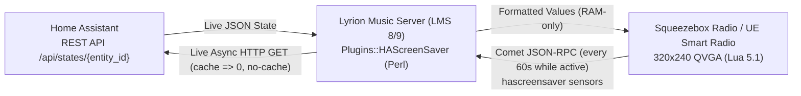

# Home Assistant Screensaver for Lyrion Music Server & Squeezebox Radio

[](https://github.com/Nornode/lms-ha-screensaver/actions/workflows/ci.yml)
[](https://github.com/Nornode/lms-ha-screensaver/releases)
[](./LICENSE)

A clean, glanceable **digital clock screensaver for Logitech Squeezebox Radio & UE Smart Radio** (SqueezePlay / SqueezeOS `baby`, 320×240 QVGA) powered by a stateless **Lyrion Music Server (LMS 8.x / 9.x)** plugin that proxies live **Home Assistant** sensor data, weather conditions, and door/alert statuses with **zero long-term caching**.

Designed for room-distance readability on 2.4" Squeezebox Radio displays—large crisp time on a dark shaded gradient background, bottom-center weather icon, lower-left and lower-right temperatures with prominent digits and subtle labels/units, a muted radio alarm indicator, and an optional door-open alert pill that stays hidden when everything is closed.

---

## Features

- **Large Digital Clock (`HH:MM`)**: Clean, high-contrast time (no seconds, no date) with a subtle drop shadow on a smooth dark charcoal-to-black vertical gradient. Respects your radio's 12h/24h setting.
- **Bottom-Center Weather Symbol**: Displays a crisp anti-aliased weather glyph (`sunny`, `clear_night`, `partlycloudy`, `cloudy`, `rainy`, `pouring`, `snowy`, `fog`, `lightning`, `windy`) from any Home Assistant `weather.*` entity.
- **Up to 4 Live Home Assistant Sensors**:
  - **1–2 sensors**: Lower-left (e.g. Outside Temperature) and lower-right (e.g. Average Indoor Temperature) flanking the center weather icon.
  - **3–4 sensors**: Stacks cleanly into left and right columns around the weather icon.
  - **Readable typography**: Large bright bold values (`28px`) paired with smaller muted units (`14px`) and subtle labels (`11px`).
- **Subtle Radio Alarm Indicator**: Shows a muted bell icon and next scheduled alarm time (`HH:MM`) in the top-right corner when an alarm is active on that specific radio.
- **Optional Door / Alert Banner**: Displays an alert pill with a door icon in the top-left corner **only** when a configured `binary_sensor` or text sensor is active (automatically hidden when `off`, `closed`, `none`, `ok`, or empty).
- **Zero Long-Term Caching (LMS & Radio)**:
  - LMS fetches Home Assistant live on demand via non-blocking `Slim::Networking::SimpleAsyncHTTP` with `cache => 0` and `Cache-Control: no-cache`, discarding values immediately after responding.
  - The Squeezebox Radio holds readings strictly in transient RAM while the screensaver is active, clears stale readings to `--` if refreshes fail, and never writes sensor data to flash storage.
- **Graceful Error Handling**: If any or all Home Assistant entities fail or return `unavailable`, the screensaver continues rendering the digital clock cleanly and displays `--` for missing sensors.
- **Native Home Assistant Add-on Support**: Automatically authenticates via the Home Assistant Supervisor API (`$ENV{SUPERVISOR_TOKEN}`) when LMS runs as an HA Add-on (e.g. `pssc/ha-addon-lms`), with optional custom URL + Long-Lived Access Token support for standalone LMS servers.
- **Event-Driven Instant Refresh**: Exposes `["", ["hascreensaver", "refresh"]]` over LMS JSON-RPC so Home Assistant automations (e.g. door contact opened) can trigger an immediate update.

---

## Architecture



---

## Installation

### Step 1: Add the Repository in Lyrion Music Server

1. Open your **Lyrion Music Server** Web UI → **Settings → Plugins** (or **Manage Plugins**).
2. Scroll to **Additional Repositories** and add:
   ```text
   https://raw.githubusercontent.com/Nornode/lms-ha-screensaver/main/repo.xml
   ```
3. Click **Apply** and restart Lyrion Music Server if prompted.
4. Enable **Home Assistant Screensaver** in the plugin list and restart LMS.

### Step 2: Configure Home Assistant Entities in LMS

Open **Settings → Plugins → Home Assistant Screensaver**:

- **Home Assistant Connection**:
  - **Home Assistant Add-on (e.g. `pssc/ha-addon-lms`)**: Leave URL and Token blank — the plugin auto-connects via the local Supervisor API (`mode: supervisor`).
  - **Standalone LMS**: Enter your Home Assistant URL (e.g. `http://homeassistant.local:8123`) and a **Long-Lived Access Token**.
- **Update Interval**: Default `60` seconds (configurable `10`–`300`s).
- **Clock Font**: `FreeSansBold` (default) or `FreeSans` (built into Squeezebox Radio).
- **Weather Entity ID** *(optional)*: Any `weather.*` entity (e.g. `weather.home`).
- **Alert / Door Contact Entity ID** *(optional)*: A `binary_sensor.*` (e.g. `binary_sensor.front_door`) or a template `sensor.*` listing open doors (hidden automatically when `off`/`closed`/`none`/`ok`/empty).
- **Sensors 1–4**: Enter entity IDs, optional short labels, decimal places, and optional unit overrides.
  - **Slot 1** displays on the **lower-left** (e.g. `sensor.outside_temperature`).
  - **Slot 2** displays on the **lower-right** (e.g. `sensor.indoor_temperature`).
  - **Slots 3 & 4** stack beneath Slots 1 & 2 when configured.

### Step 3: Install the Applet on Your Squeezebox Radio

1. On your Squeezebox Radio / UE Smart Radio, open **Settings → Advanced → Applet Installer**.
2. Uncheck **Recommended Applets Only**.
3. Select **Home Assistant Clock** → **Install** (the radio downloads the `.zip`, verifies its SHA-1, installs, and restarts).
4. Enable it under **Settings → Screen → Screensavers** (*When Off*, *When Stopped*, and/or *When Playing*).

*(Tip: The LMS plugin also self-hosts a local LAN repository at `http://<YOUR_LMS_HOST>:9000/plugins/HAScreenSaver/repo.xml` for completely offline LAN distribution.)*

---

## Optional: Instant Refresh from Home Assistant Automations

To push an immediate refresh when a door opens, call LMS JSON-RPC from a Home Assistant `rest_command`:

```yaml
rest_command:
  lms_screensaver_refresh:
    url: "http://<YOUR_LMS_HOST>:9000/jsonrpc.js"
    method: POST
    content_type: "application/json"
    payload: '{"id":1,"method":"slim.request","params":["",["hascreensaver","refresh"]]}'
```

---

## Local Development & Testing

```bash
# Run Perl & Lua 5.1 unit tests (88 automated checks)
./scripts/test.sh

# Build radio applet zip (dist/HAScreenSaver.zip)
./scripts/build.sh

# Build full release artifacts + repo.xml
./scripts/release.sh 1.0.0 Nornode/lms-ha-screensaver
```

For fast local deployment to your own LMS server and a single test radio over SSH, copy `.env.example` to `.env.local` (gitignored) and use `./scripts/deploy-lms.sh`, `./scripts/deploy-radio.sh`, and `./scripts/test-lms-rpc.sh`.

---

## License

MIT — see [LICENSE](./LICENSE).
