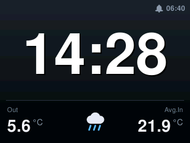
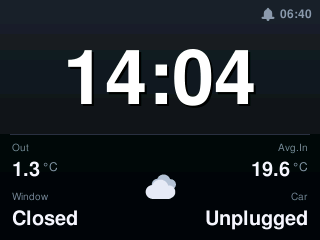
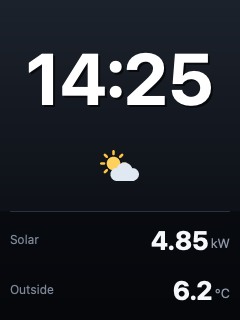
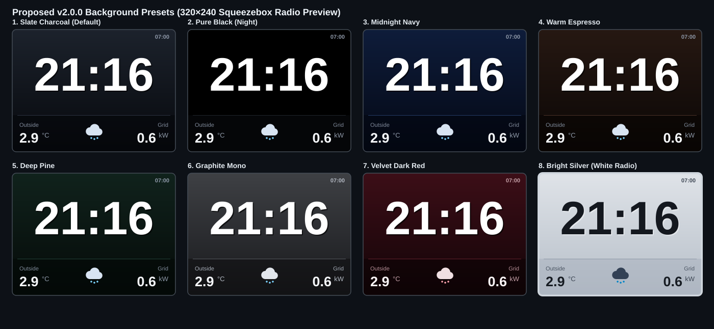
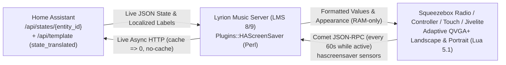

# Home Assistant Screensaver for Lyrion Music Server & Squeezebox

[](https://github.com/Nornode/lms-ha-screensaver/actions/workflows/ci.yml)
[](https://github.com/Nornode/lms-ha-screensaver/releases)
[](./LICENSE)

A clean, glanceable **digital clock screensaver for Logitech Squeezebox Radio (`baby`, 320×240), Squeezebox Controller (`jive`, 240×320 portrait), Squeezebox Touch (`fab4`, 480×272), and Jivelite**, powered by a stateless **Lyrion Music Server (LMS 8.x / 9.x)** plugin that proxies live **Home Assistant** sensors, weather conditions, and door/alert statuses with **zero long-term caching**.

<table>
  <tr>
    <td align="center">
      <br/>
      <em>Radio 320×240 — 2-sensor layout</em>
    </td>
    <td align="center">
      <br/>
      <em>Radio 320×240 — 4-sensor 2×2 layout</em>
    </td>
    <td align="center">
      <br/>
      <em>Controller 240×320 — Portrait rows</em>
    </td>
  </tr>
</table>

---

## Highlights

- **Crisp Digital Clock (`HH:MM`)** with subtle drop shadow, respecting each player's 12h/24h setting.
- **All 15 Home Assistant Weather Glyphs** rendered cleanly at `56×56` (Large default, with optional Compact `44×44`) in both dark-background and light-background variants — see [Weather Glyphs & Sensors](docs/weather-and-sensors.md).
- **Up to 4 Live Home Assistant Sensors** supporting numeric values as well as localized `binary_sensor.*`, `lock.*`, `cover.*`, and `person.*` states, plus an optional door/alert banner and player alarm badge.
- **Optional Appearance & Theming (v2.0.0)**: 8 procedural background presets (including **Pure Black**, **Velvet Dark Red**, and **Bright Silver** for white radios), plus optional label weight/size, clock/value size, and custom hex colors — all configurable globally and per radio while keeping the classic **Slate Charcoal** default untouched. See [Appearance & Theming](docs/appearance.md).
- **Per-Radio Overrides & 6 Languages**: Override sensors, weather, alerts, font, or appearance per player in LMS Player Settings. Localized in **DE, EN, ES, FI, FR, and SV**.
- **Zero Long-Term Caching**: Live non-blocking async HTTP on LMS (`cache => 0`, `no-cache`) and RAM-only transient state on Squeezebox devices. Native Home Assistant Add-on Supervisor auto-auth or standalone URL + Long-Lived Access Token.



---

## Architecture (Zero Long-Term Caching)



---

## Quick Start

### 1. Install the LMS Plugin
1. In Lyrion Music Server, open **Settings → Plugins → Additional Repositories** and add:
   ```text
   https://raw.githubusercontent.com/Nornode/lms-ha-screensaver/main/repo.xml
   ```
2. Click **Apply**, enable **Home Assistant Screensaver**, and restart LMS.

### 2. Configure Sensors & Optional Appearance
Open **Settings → Plugins → Home Assistant Screensaver**:
- **Home Assistant Connection**: Leave blank when running LMS as a Home Assistant Add-on (auto-connects via Supervisor API), or enter your HA URL + Long-Lived Access Token.
- **Weather, Alert & Sensors 1–4**: Add your `weather.*` entity, optional door/alert entity, and up to 4 sensors.
- **Appearance (Optional)**: Keep defaults or customize background, weather glyph size, label size/weight, and hex colors globally or per player.

### 3. Install the Applet on Your Squeezebox
The LMS plugin automatically advertises **Home Assistant Clock** over plain local HTTP to connected Squeezebox devices:
1. On your Radio, Controller, Touch, or Jivelite, go to **Settings → Advanced → Applet Installer**.
2. Select **Home Assistant Clock → Install**.
3. Enable it under **Settings → Screen → Screensavers**.

---

## Detailed Documentation

- **[Appearance & Theming](docs/appearance.md)** — All 8 background presets, Bright Silver white-radio theme, size/weight controls, and embedded hex color pickers.
- **[Weather Glyphs, Sensors & Per-Radio Overrides](docs/weather-and-sensors.md)** — Full table of all 15 Home Assistant weather states, localized binary/lock/cover sensors, per-player override rules, and Home Assistant instant-refresh automation.
- **[Architecture & Local Development](docs/development.md)** — Zero-cache architecture diagram, icon generation, unit tests, packaging, and SSH deploy scripts.

---

## License

MIT — see [LICENSE](./LICENSE).
