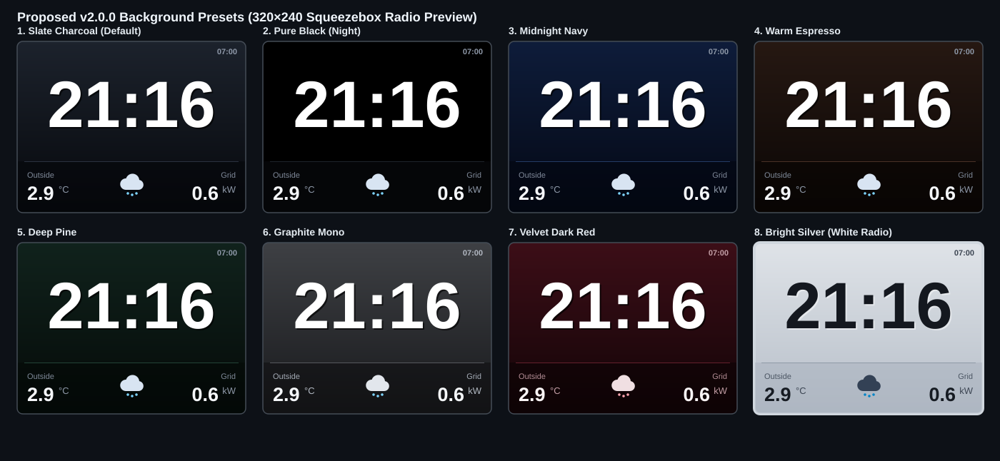

# Appearance & Theming (v2.0.0)

All appearance settings are **100% optional** and configurable both **globally** (**Settings → Plugins → Home Assistant Screensaver**) and **per radio/player** (**Settings → Player → [Radio] → Home Assistant Screensaver**).

Out of the box, the screensaver keeps its classic **Slate Charcoal** look with quiet, glanceable labels. Any field left blank or set to *Default* / *Use Global Default* inherits automatically.

---

## Background Presets

All 8 backgrounds are rendered procedurally on-device (zero extra bitmap bloat, scales cleanly across Radio `320×240`, Controller `240×320`, Touch `480×272`, and Jivelite):

| Preset | ID | Description |
| :--- | :--- | :--- |
| **Slate Charcoal (Default)** | `slate` | Classic dark blue-charcoal vertical gradient (`#1C222C` → `#06080C`). |
| **Pure Black (Night)** | `black` | Flat `#000000` background with minimal backlight glow for dark bedrooms. |
| **Midnight Navy** | `midnight` | Deep cool navy gradient (`#0E1C3A` → `#040814`). |
| **Warm Espresso** | `ember` | Warm dark charcoal-brown gradient (`#261812` → `#0A0605`) for nightstands. |
| **Deep Pine** | `forest` | Muted dark evergreen gradient (`#10221C` → `#050A08`). |
| **Graphite Mono** | `graphite` | Neutral steel-grey gradient (`#3E4044` → `#18191C`) without blue tint. |
| **Velvet Dark Red** | `velvet` | Deep velvety burgundy gradient (`#3C0E17` → `#120407`). |
| **Bright Silver (White Radio)** | `silver` | Light silver-grey gradient (`#DFE3E8` → `#B6BEC8`) with dark charcoal text and dark-ink weather/alarm icons, designed to pair with a white Squeezebox Radio. |

---

## Optional Size, Weight & Color Overrides

| Option | Values | Default | Notes |
| :--- | :--- | :--- | :--- |
| **Weather Glyph Size** | `Large`, `Compact` | `Large` (`56×56`) | Native `56×56` crisp rendering by default; `Compact` scales to classic `44×44`. |
| **Label Size** | `Default`, `Medium (+2px)`, `Large` | `Default` | Helpful on lower-contrast displays such as Squeezebox Controller. |
| **Label Weight** | `Regular`, `Bold` | `Regular` | Switches sensor labels from `FreeSans` to `FreeSansBold`. Per-radio setting supports explicit override back to Regular even when global Bold is enabled. |
| **Value Size** | `Compact`, `Default`, `Large` | `Default` | Adjusts numeric/text sensor value size with automatic vertical clamping. |
| **Clock Size** | `Compact`, `Default`, `Large` | `Default` | Scales the `HH:MM` clock while clamping cleanly against screen width and bottom band. |
| **Custom Hex Colors** | `#RRGGBB` (optional) | *Blank (preset default)* | Independently customize **Clock**, **Sensor Value**, **Label**, and **Unit** colors using the embedded color picker swatch or by typing a `#RRGGBB` hex code. Click `×` to reset back to default/inherited. |
