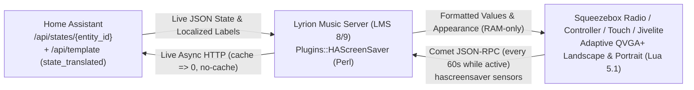

# Architecture & Local Development

## Architecture (Zero Long-Term Caching)



- **LMS Plugin**: Fetches Home Assistant live on demand via non-blocking `Slim::Networking::SimpleAsyncHTTP` with `cache => 0` and `Cache-Control: no-cache`, discarding sensor values immediately after responding.
- **Radio Applet**: Holds readings and resolved colors strictly in transient RAM while the screensaver window is active, expires stale values to `--` after `2.5 × poll_interval`, and never writes sensor data to flash storage.

---

## Local Testing & Packaging

```bash
# Run Perl & Lua 5.1 unit tests
./scripts/test.sh

# Regenerate all 33 anti-aliased 56x56 weather & status PNG icons
python3 scripts/generate-icons.py

# Build flat radio applet zip (dist/HAScreenSaver.zip + AppletDist/)
./scripts/build.sh

# Build full release artifacts + root repo.xml
./scripts/release.sh 2.0.0 Nornode/lms-ha-screensaver
```

For fast local deployment to your own LMS server and a single test radio over SSH, copy `.env.example` to `.env.local` (gitignored) and use:
- `./scripts/deploy-lms.sh`
- `./scripts/deploy-radio.sh`
- `./scripts/test-lms-rpc.sh [player_mac]`
