# Weather Glyphs, Sensors & Per-Radio Overrides

## Weather Glyphs (All 15 Home Assistant Conditions)

Enter any Home Assistant `weather.*` entity (e.g., `weather.home`) in **Weather Entity ID** to show a live weather glyph:
- **Landscape (`320×240` Radio, `480×272` Touch, Jivelite)**: Centered between sensor columns in the bottom band.
- **Portrait (`240×320` Controller)**: Centered above the divider between the clock and sensor rows.
- **Sizing**: Defaults to **Large** (native `56×56` 4× supersampled anti-aliased PNGs) with an optional **Compact** (`44×44`) mode in Appearance settings.
- **Light & Dark Icons**: Every condition ships in both standard (dark-background) and dark-ink (`*_dark.png`, used automatically with the **Bright Silver** theme) variants.

All **15 official Home Assistant `weather.*` states** have dedicated glyphs:

| Dark BG | Light BG (Silver) | Home Assistant State | Alias(es) | Icon Key | Description |
| :---: | :---: | :--- | :--- | :--- | :--- |
|  |  | `sunny` | `clear` | `sunny` | Golden sun with 8 rays |
|  |  | `clear-night` | — | `clear_night` | Crescent moon with stars |
|  |  | `partlycloudy` | `partly-cloudy` | `partlycloudy` | Sun peeking behind cloud |
|  |  | `cloudy` | `overcast` | `cloudy` | Layered clouds |
|  | 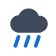 | `rainy` | `rain` | `rainy` | Cloud with rain drops |
| 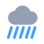 | 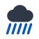 | `pouring` | — | `pouring` | Dark cloud with heavy downpour |
| 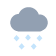 | 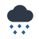 | `hail` | — | `hail` | Dark cloud with hail pellets |
|  |  | `snowy` | `snow` | `snowy` | Cloud with snowflakes |
|  | 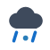 | `snowy-rainy` | — | `snowy_rainy` | Cloud with mixed rain and snow |
|  |  | `fog` | `mist` | `fog` | Cloud with horizontal mist bars |
| 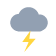 | 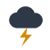 | `lightning` | — | `lightning` | Dark cloud with lightning bolt |
| 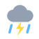 | 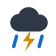 | `lightning-rainy` | — | `lightning_rainy` | Dark cloud with lightning bolt & rain |
|  |  | `windy` | — | `windy` | Wind gusts |
|  |  | `windy-variant` | — | `windy_variant` | Cloud with wind gusts |
|  |  | `exceptional` | — | `exceptional` | Weather alert warning triangle |

---

## Live Sensors (Up to 4 Slots)

Configure 1 to 4 entities under **Home Assistant Sensors — Global Defaults**:

- **Numeric sensors** (`sensor.*`): Rounded to configured decimals (`0`–`4`), using Home Assistant's `unit_of_measurement` unless a custom unit override is set.
- **Binary & categorical entities** (`binary_sensor.*`, `lock.*`, `cover.*`, `person.*`): Automatically localized via Home Assistant's `state_translated()` (HA 2024.3+, with built-in English `device_class` fallback) so doors show *Open/Closed*, locks show *Locked/Unlocked*, etc.
- **Adaptive layouts**:
  - **Landscape**: 1–2 sensors flank the weather glyph; 3–4 sensors use 1 row on widescreen (`480×272`) or a 2×2 grid on `320×240`.
  - **Portrait (`240×320`)**: 1 sensor centers full-width; 2 sensors stack as full-width horizontal rows; 3–4 sensors use a 2×2 grid.
- **Optional Alert / Door Banner**: Displays an alert pill with a door icon in the top-left corner **only** when active (automatically hidden when `off`, `closed`, `none`, `ok`, or empty).

---

## Per-Radio Overrides

Customize any individual radio without affecting others:

- **Classic LMS Skin**: **Settings → Player → [Select Radio] → Home Assistant Screensaver**
- **Material Skin**: **Settings → Player Settings → [Radio] → Extra Settings → Home Assistant Screensaver**

Rules for every player override:
1. **Leave blank / Use Global Default** → inherits the Global Default.
2. **Enter an Entity ID / choose an option** → overrides that item for this radio only.
3. **Enter `none`** (for weather, alert, or sensor slots) → hides a Global Default on this radio.
4. **Reset Overrides** → clears all custom settings on this radio in one click.

*Squeezebox Controller (`jive`)* automatically follows the currently selected player's overrides and alarm status, falling back to Global Defaults if no player is selected.

---

## Optional: Instant Refresh from Home Assistant Automations

Push an immediate screensaver refresh (e.g., when a door opens) via LMS JSON-RPC:

```yaml
rest_command:
  lms_screensaver_refresh:
    url: "http://<YOUR_LMS_HOST>:9000/jsonrpc.js"
    method: POST
    content_type: "application/json"
    payload: '{"id":1,"method":"slim.request","params":["",["hascreensaver","refresh"]]}'
```
